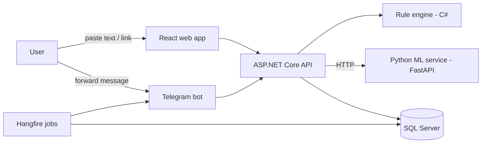

# RedFlag — Fake Job-Offer & Scam Detector

> Paste a recruiter message, job post or link. Get a **risk score with plain-language reasons** — on the web or through a Telegram bot.

**Status:** 🚧 In development (Week 0 — setup). Update this line as you progress.

<!-- Add after Week 5: demo video link, 2–3 screenshots, live URL (if any) -->

---

## The problem

Job seekers in India, especially freshers, are targeted by recruitment scams: "registration fees", fake offer letters on real company letterheads, fake interview rounds on WhatsApp or Telegram, and fake placement agencies. The Delhi Police cyber cell describes the common pattern: fraudsters demand fees for registration, document verification or interview scheduling, then stop responding. Police actions in 2026 show these rackets still operate, with complaints filed on the National Cyber Crime Reporting Portal.

Most existing advice is a blog checklist. **RedFlag turns that checklist into a tool** that explains *why* a message looks risky, so the user can decide before paying or sharing documents.

## Features

- [ ] **Risk analysis** of pasted text or a link, with a 0–100 score and Low / Medium / High level
- [ ] **Explainable results:** each red flag shown with a short reason (not just a number)
- [ ] **Telegram bot:** forward a message and get a verdict
- [ ] **Background jobs** (Hangfire): refresh scam-pattern lists, daily admin digest, report cleanup
- [ ] **ML classifier** (Python / FastAPI) that improves the rule-based score; the app falls back to rules if the service is down
- [ ] **Admin dashboard:** trending scam types, flag frequency, reports per day
- [ ] **Privacy by design:** phone numbers, emails and ID numbers are masked before anything is stored

## How it works



**Scoring:** a weighted rule engine checks signals such as fee or deposit requests, free-email recruiters, WhatsApp/Telegram-only contact, urgency wording, unrealistic pay for the role, early requests for ID or bank details, and shortened or look-alike links. The ML model adds a text-based probability. The final score blends both and always lists the triggered rules.

## Tech stack

| Layer | Technology |
|---|---|
| Backend | ASP.NET Core (.NET 10), C#, Entity Framework Core |
| Database | SQL Server |
| Frontend | React.js (Vite) |
| Auth | JWT with role-based access (Admin / User) |
| Automation | Hangfire, Telegram Bot API |
| ML service | Python, FastAPI, scikit-learn, Pandas |
| Testing & DevOps | xUnit, Docker, GitHub Actions |

## Getting started

> Fill this section in as you build. Final version should let a stranger run the project in under 10 minutes.

```bash
# 1. Clone
git clone <your-repo-url>
cd redflag

# 2. Backend
cd backend/RedFlag.Api
dotnet user-secrets set "ConnectionStrings:Default" "<your connection string>"
dotnet user-secrets set "Telegram:BotToken" "<token from @BotFather>"
dotnet ef database update
dotnet run

# 3. Frontend
cd ../../frontend
npm install
npm run dev

# 4. ML service
cd ../ml-service
python -m venv .venv && source .venv/bin/activate   # Windows: .venv\Scripts\activate
pip install -r requirements.txt
uvicorn app.main:app --reload --port 8000
```

Never commit secrets. Use `dotnet user-secrets` locally and environment variables in Docker.

## API (planned)

| Method | Endpoint | Description |
|---|---|---|
| POST | `/api/analyze` | Analyze text or a URL; returns score, level and triggered flags |
| GET | `/api/reports/{id}` | Fetch a saved analysis |
| POST | `/api/auth/login` | Get a JWT |
| GET | `/api/admin/trends` | Trending flags and scam types (Admin only) |
| POST (ML service) | `/predict` | Returns scam probability for a text |

Swagger / OpenAPI docs are available at `/swagger` (or the OpenAPI endpoint) when running locally.

## ML evaluation

Fill with **your real results**. Do not report accuracy alone because the data is imbalanced.

| Model | Dataset | Precision | Recall | F1 | PR-AUC |
|---|---|---|---|---|---|
| TF-IDF + Logistic Regression (baseline) | EMSCAD (test split) | _TBD_ | _TBD_ | _TBD_ | _TBD_ |
| _Improved model_ | EMSCAD (test split) | _TBD_ | _TBD_ | _TBD_ | _TBD_ |
| Rules + ML blend | Hand-labelled India-style messages | _TBD_ | _TBD_ | _TBD_ | _TBD_ |

## Limitations

- The public training dataset (EMSCAD) contains English-language job ads from 2012–2014, mostly from English-speaking countries, and only about 5% are fraudulent. It does not reflect modern WhatsApp or Telegram scam messages, so rules carry most of the weight and the ML model is a supporting signal.
- RedFlag gives a **risk score, not a verdict**. A high score means "be careful and verify", and a low score does not guarantee a genuine offer.
- It does not check company registration or verify identities.

## Privacy & ethics

- Personal data (phone numbers, emails, Aadhaar/PAN-like numbers, bank details) is masked before storage.
- Raw submissions are not kept by default; only masked text and rule results are saved.
- Never name or accuse a real company or person as a scammer based on a score.
- If you've been targeted: report on the National Cyber Crime Reporting Portal or call **1930**.

## Roadmap

- [ ] Week 1: API, database, JWT, rule engine with unit tests
- [ ] Week 2: React UI and saved reports
- [ ] Week 3: Telegram bot and Hangfire jobs
- [ ] Week 4: Python ML service and fallback logic
- [ ] Week 5: Admin dashboard, Docker, CI, demo video

## Author

**Nikita Todkar** — [LinkedIn](https://www.linkedin.com/in/nikitatodkar/) · nikitatodkar009@gmail.com
